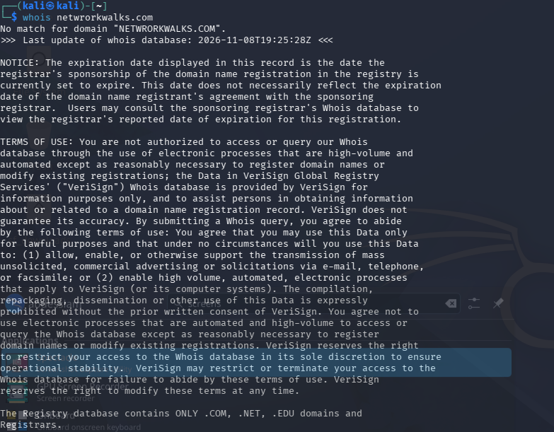
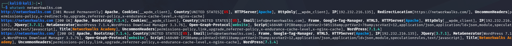
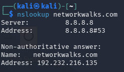
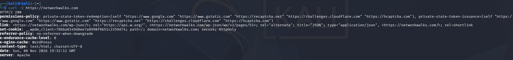
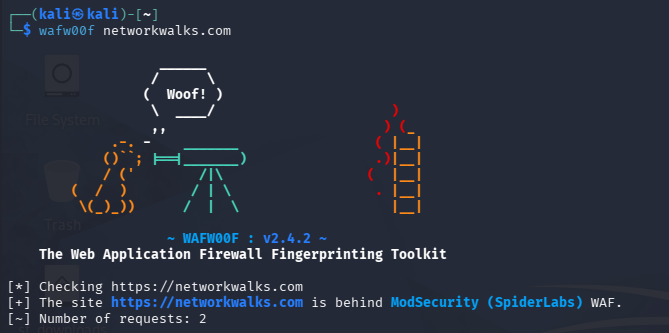
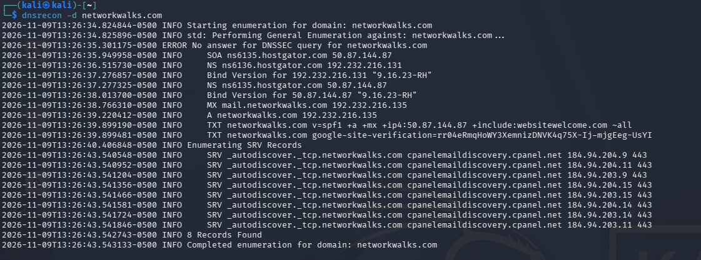
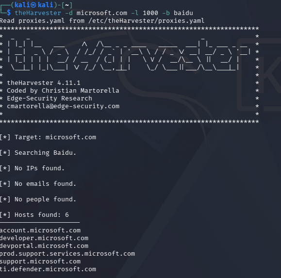
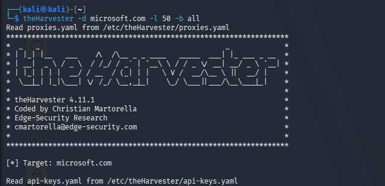

# Cybersecurity Internship -- Week 2

A documentation of my completed Week 2 cybersecurity internship practicals. The work focused on **footprinting and reconnaissance**, **OSINT**, and **local network discovery** using Kali Linux and Windows tools.

> **Educational use only:** These exercises were completed for learning and defensive security awareness. Only perform reconnaissance or scanning on systems you own or have explicit written permission to test.

## Table of Contents

-   [Overview](#overview)
-   [Tools and Technologies](#tools-and-technologies)
-   [Completed Tasks](#completed-tasks)
    -   [Project Module 1 -- Footprinting with Kali Linux](#1-project-module-1--footprinting-with-kali-linux)
    -   [Project Module 3 -- Footprinting with Maltego](#2-project-module-3--footprinting-with-maltego)
    -   [Project Module 4 -- Reconnaissance with theHarvester](#3-project-module-4--reconnaissance-with-theharvester)
    -   [Project Module 5 -- Network Scanning with Zenmap](#4-project-module-5--network-scanning-with-zenmap)
-   [Evidence and Screenshots](#evidence-and-screenshots)
-   [Key Learnings](#key-learnings)
-   [Disclaimer](#disclaimer)

## Overview

During Week 2, I completed practical exercises designed to introduce common reconnaissance and network-discovery techniques. I used passive information-gathering tools to identify publicly available domain information, fingerprint website technologies, enumerate DNS data, and collect publicly indexed email addresses and subdomains. I also used Zenmap to discover active devices on a local network and export a network topology.

The exercises covered in this documentation are:

| Module | Practical |
| :--- | :--- |
| **W2-PM1** | Footprinting and reconnaissance with multiple Kali Linux tools |
| **W2-PM3** | Footprinting with Maltego |
| **W2-PM4** | Footprinting and reconnaissance with theHarvester |
| **W2-PM5** | Network scanning with Zenmap |

## Tools and Technologies

-   **Kali Linux** -- Linux distribution used for security and reconnaissance tools
-   **WHOIS** -- Domain registration information lookup
-   **WhatWeb** -- Website technology fingerprinting
-   **nslookup** -- DNS lookup and domain-to-IP resolution
-   **curl** -- HTTP response-header inspection
-   **WAFW00F** -- Web Application Firewall detection
-   **DNSRecon** -- DNS record enumeration
-   **Maltego** -- OSINT and relationship mapping
-   **theHarvester** -- Collection of publicly available emails, hosts, and subdomains
-   **Zenmap / Nmap** -- Network discovery and scanning
-   **Windows Command Prompt** -- Local IP and network configuration inspection

## Completed Tasks

### 1. Project Module 1 -- Footprinting with Kali Linux

**Objective:** Build a basic public-information profile of `networkwalks.com` using six Kali Linux tools.

| Task | Tool | Command | Purpose |
| :--- | :--- | :--- | :--- |
| 1 | WHOIS | `whois networkwalks.com` | Retrieve public domain registration details |
| 2 | WhatWeb | `whatweb networkwalks.com` | Identify website technologies |
| 3 | nslookup | `nslookup networkwalks.com` | Resolve the domain through DNS |
| 4 | curl | `curl -I https://networkwalks.com` | Inspect HTTP response headers |
| 5 | WAFW00F | `wafw00f networkwalks.com` | Check for a Web Application Firewall |
| 6 | DNSRecon | `dnsrecon -d networkwalks.com` | Enumerate publicly available DNS records |

**Observed Outputs & Findings:**

-   **WHOIS:** Verified domain query behavior in the registry database (note: testing with a typo such as `netwrorkwalks.com` returns `No match for domain`).
-   **WhatWeb:** Identified the target IP (`192.232.216.135`), Apache web server, WordPress, Bootstrap (`7.1.4`), jQuery (`3.7.1`), Google Tag Manager, HTTP `301` redirect to HTTPS (`200 OK`), and exposed contact email (`info@networkwalks.com`).
-   **nslookup:** Resolved `networkwalks.com` via public DNS (`8.8.8.8`) to the IPv4 address `192.232.216.135`.
-   **curl:** Confirmed `HTTP/2 200` response status, `Apache` server header, `WordPress` (`x-nginx-cache`), `HttpOnly` session cookies (`__wpdm_client`), and security headers (`permissions-policy`, `referrer-policy`).
-   **WAFW00F:** Detected that `https://networkwalks.com` is protected behind a **ModSecurity (SpiderLabs)** Web Application Firewall.
-   **DNSRecon:** Enumerated SOA and NS records (`ns6135.hostgator.com`, `ns6136.hostgator.com`), Bind versions (`9.16.23-RH`), MX records (`mail.networkwalks.com`), A records (`192.232.216.135`), SPF/Google site verification TXT records, and 8 autodiscover SRV records.

### 2. Project Module 3 -- Footprinting with Maltego

**Objective:** Install and configure Maltego, then use its transforms to discover email addresses associated with the authorized target domain `networkwalks.com`.

**Tasks completed:**

1.  Downloaded and installed Maltego on Windows.
2.  Launched Maltego and completed the initial configuration.
3.  Created a free Maltego account and signed in.
4.  Added a Domain entity to the graph.
5.  Set the entity value to `networkwalks.com`.
6.  Filtered for email-related transforms and ran them to retrieve related results.

**What I practised:**

-   Setting up an OSINT investigation workspace.
-   Working with domain entities and graph-based relationships.
-   Running transforms to discover publicly associated email addresses.

### 3. Project Module 4 -- Reconnaissance with theHarvester

**Objective:** Use theHarvester in Kali Linux to gather publicly available email addresses and subdomains associated with `microsoft.com`.

**Task 1 -- Search using Baidu (limit: 1,000 results):**

```bash
theHarvester -d microsoft.com -l 1000 -b baidu
```

-   **Observed Output:** Discovered **6 hosts/subdomains** (`account.microsoft.com`, `developer.microsoft.com`, `devportal.microsoft.com`, `prod.support.services.microsoft.com`, `support.microsoft.com`, and `ti.defender.microsoft.com`), with 0 IPs, emails, or people returned from this source.

**Task 2 -- Search using all supported sources (limit: 50 results):**

```bash
theHarvester -d microsoft.com -l 50 -b all
```

-   **Observed Output:** Initiated multi-source OSINT enumeration across all configured public engines and API sources.

*Note: theHarvester results can vary over time because external search engines and data providers change their indexed information and availability.*

### 4. Project Module 5 -- Network Scanning with Zenmap

**Objective:** Use Zenmap on Windows to discover live hosts on a local network and export the scan topology.

**Tasks completed:**

1.  Downloaded and installed Zenmap from the official Nmap download page.
2.  Used `ipconfig` in Windows Command Prompt to identify the local IP configuration and LAN subnet.
3.  Entered the local subnet in Zenmap.
4.  Selected **Ping Scan** to discover live hosts.
5.  Identified the number of live hosts.
6.  Reviewed the discovered hosts and their network-address information.
7.  Displayed the network topology, enabled the legend, and exported the topology as a PDF.

**Command used to inspect local network configuration:**

```cmd
ipconfig
```

To inspect additional adapter details, including the local physical address:

```cmd
ipconfig /all
```

**Result recorded in the lab:** 4 live hosts were discovered, including the scanning computer.

**Privacy note:** Private LAN IP addresses and MAC addresses are intentionally not reproduced in this public README. Keep detailed network scan output in a private or appropriately sanitized evidence folder before publishing your repository.

## Evidence and Screenshots

Below are the screenshots captured during the practical exercises:

### Project Module 1 -- Footprinting with Kali Linux

-   **WHOIS Lookup:**
    
-   **WhatWeb Fingerprinting:**
    
-   **nslookup DNS Resolution:**
    
-   **curl HTTP Response Headers:**
    
-   **WAFW00F Firewall Detection:**
    
-   **DNSRecon Record Enumeration:**
    

### Project Module 4 -- Reconnaissance with theHarvester

-   **theHarvester (Baidu Source):**
    
-   **theHarvester (All Sources):**
    

## Key Learnings

By completing these practicals, I gained hands-on experience with:

-   The role of reconnaissance in the cybersecurity assessment process.
-   Using WHOIS and DNS utilities to gather domain information.
-   Fingerprinting web technologies and inspecting HTTP headers.
-   Understanding the purpose of Web Application Firewall detection (e.g., identifying ModSecurity).
-   Using Maltego to visualize relationships and perform OSINT.
-   Using theHarvester to collect subdomains and hosts from public sources.
-   Discovering live devices on a local subnet with Zenmap.
-   Recording technical results and exporting scan evidence.

## Disclaimer

This repository documents educational internship exercises. The commands and techniques are intended for authorized learning, security assessment, and defensive purposes only.

Only investigate domains, devices, and networks that you own or for which you have explicit permission. Do not use these techniques for unauthorized access, disruption, credential attacks, or any unlawful activity.

------------------------------------------------------------------------

**Internship practicals:** Week 2  
**Focus:** Cybersecurity, Ethical Hacking, OSINT, Reconnaissance, and Network Scanning
